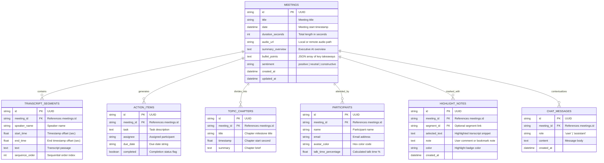

# 🪰 Fireflies.ai Clone — Meeting Notes & AI Transcription Platform

A full-stack, production-ready clone of the **Fireflies.ai** meeting assistant web application. It replicates the core post-meeting workspace, interactive synchronized audio transcripts, AI-generated executive summaries, action item management, and an LLM-powered "Ask Fred" meeting Q&A chat.

Built as an evaluation submission for the **Scaler SDE Fullstack Assignment**.

---

## 🔗 Links & Live Deployment
- **Live Demo**: [https://frontend-n257.vercel.app/](https://fireflies-clone-platform.vercel.app) 
- **Backend API Docs**: [https://meeting-notes-transcription-platform-nfnz.onrender.com/docs](https://fireflies-api.onrender.com/docs) 
- **GitHub Repository**: [https://github.com/Avn2312/Meeting-Notes-Transcription-Platform](https://github.com/Avn2312/Meeting-Notes-Transcription-Platform)

---

## 📸 Overview & Key Highlights

- **Aesthetic Parity**: Recreates Fireflies' signature `#7C3AED` / `#6366F1` violet-indigo palette, responsive split-pane workspace, cards, badges, and modals.
- **Bidirectional Audio & Transcript Sync**:
  - Distinct synthesized multi-speaker audio tracks for each meeting (`meeting_1.wav`, `meeting_2.wav`, `meeting_3.wav`, `meeting_4.wav`).
  - Clicking any transcript segment seeks the audio player to that exact millisecond.
  - Playing audio highlights the active speaker block in real-time and auto-scrolls it smoothly into view.
- **Web Speech Voice Assistant (TTS)**:
  - Interactive `[🔊 Read]` button on every transcript segment to read that specific speaker line aloud in the browser.
  - `[✨ Voice Reader: ON/OFF]` toggle in the toolbar to automatically speak active segments as playback proceeds.
- **Post-Meeting Intelligence**:
  - Executive 2-paragraph overview & structured key takeaways.
  - Interactive Action Items checklist with assignees and due dates (add, toggle, edit, and delete with persistent SQLite sync).
  - Clickable Chapter Outlines that jump audio and transcript to key agenda milestones.
  - Speaker Talk-Time distribution analytics bar.
- **"Ask Fred" AI Meeting Chat**: Chat interface grounded directly in the meeting transcript to answer questions like *"What deadlines were agreed upon?"* or *"Summarize the technical decisions"*.
- **Meeting Ingestion & Parsing (CRUD)**:
  - Create meetings by pasting or uploading raw transcript files (`.txt`, `.vtt`, `.json`).
  - Intelligent parser extracts speaker timestamps, segments, chapters, action items, and participants automatically.
  - Rename meetings, update metadata, or delete with cascaded foreign-key cleanup.
- **Soundbites & Highlights**: Highlight transcript passages, tag them, and save soundbite notes.
- **Multi-Format Export**: One-click download as Markdown (`.md`), Plain Text (`.txt`), or JSON (`.json`), plus "Copy Markdown to Clipboard".
- **Global Search**: Sub-second full-text search across all meeting titles, transcripts, action items, and participants (`Cmd+K`).
- **Dark Mode / Light Mode**: Instant theme toggle with persisted user preference.
- **Realistic Placeholders**: High-fidelity modals for *"Add Fireflies to Live Call (Zoom/Meet/Teams)"* and *"Integrations (Slack, Notion, CRM)"*.

---

## 🛠️ Tech Stack

| Layer | Technology | Rationale |
| :--- | :--- | :--- |
| **Frontend** | **Next.js 16+ (App Router)** | Modern SSR/Client routing, fast Turbopack compilation, high responsiveness. |
| **Language** | **TypeScript** | Strict type safety across all meeting entities and API models. |
| **Styling** | **Tailwind CSS v4** | Clean, responsive Fireflies design tokens, dark mode variants, and smooth transitions. |
| **Icons** | **Lucide React** | Clean, lightweight icon suite. |
| **Backend** | **Python 3.14 + FastAPI** | High-performance asynchronous API framework with auto-generated OpenAPI / Swagger docs. |
| **ORM & DB** | **SQLAlchemy 2.0 + SQLite** | Clean relational data modeling, foreign key constraints, cascade deletions, and index optimization. |
| **Validation** | **Pydantic v2** | Strict schema validation for requests and responses. |

---

## 🗄️ Database Schema Design

The SQLite database uses normalized relational tables linked via foreign keys with cascading deletions:



---

## 🚀 Quickstart & Local Setup

### Single-Command Start (Recommended)
You can start both the backend and frontend concurrently using the provided runner script:
```bash
./run.sh
```
This automatically initializes the virtual environment, installs dependencies, seeds the database, compiles styles, and launches:
- **FastAPI Backend**: `http://127.0.0.1:8000` (API Docs at `/docs`)
- **Next.js Frontend**: `http://localhost:3000`

---

### Manual Step-by-Step Setup

### Prerequisites
- **Node.js** (v18+) & **npm**
- **Python** (v3.10+)

### 1. Clone & Set Up Backend
```bash
# Navigate to backend directory
cd backend

# Create and activate Python virtual environment
python3 -m venv venv
source venv/bin/activate  # On Windows: venv\Scripts\activate

# Install dependencies
pip install -r requirements.txt

# Initialize database and populate rich sample seed meetings
python seed.py

# Start the FastAPI backend server
uvicorn main:app --host 127.0.0.1 --port 8000 --reload
```
The FastAPI backend will run at **`http://127.0.0.1:8000`**.  
Interactive Swagger documentation is available at **`http://127.0.0.1:8000/docs`**.

### 2. Set Up Frontend
In a new terminal window:
```bash
# Navigate to frontend directory
cd frontend

# Install npm dependencies
npm install

# Start the Next.js development server
npm run dev
```
Open **`http://localhost:3000`** in your browser. Next.js proxies all `/api/*` calls automatically to the backend on `http://127.0.0.1:8000`.

---

## 🧪 Automated Integration Tests

To run the verification test suite covering all 11 backend endpoints and workflows:
```bash
cd backend
source venv/bin/activate
python test_api_direct.py
```
This tests:
1. Health check `/api/health`
2. Meeting list with search, speaker filter, and sorting
3. Meeting detail retrieval with transcript segments, action items, and chapters
4. Transcript upload with auto-parsing and summary generation
5. Action item lifecycle (create, toggle complete, delete)
6. Soundbite / highlight persistence
7. Ask Fred AI chat responses
8. Global search across all meetings
9. Multi-format export (Markdown, Plain Text, JSON)
10. Cascading meeting deletion

---

## 📡 API Overview

| Method | Endpoint | Description |
| :--- | :--- | :--- |
| `GET` | `/api/health` | Health check endpoint. |
| `GET` | `/api/meetings` | List meetings with `search`, `speaker`, `sort_by` query params. |
| `GET` | `/api/meetings/{id}` | Full meeting detail (transcript, chapters, action items, participants, chat history). |
| `POST` | `/api/meetings` | Create meeting manually. |
| `POST` | `/api/meetings/upload` | Ingest transcript text or `.txt`/`.vtt`/`.json` file; auto-extracts segments, chapters, and summary. |
| `PATCH` | `/api/meetings/{id}` | Update meeting metadata (title, participants). |
| `DELETE` | `/api/meetings/{id}` | Delete meeting and all child records (cascade). |
| `POST` | `/api/meetings/{id}/action-items` | Add a new action item to a meeting. |
| `PATCH` | `/api/action-items/{id}` | Update action item (toggle `completed`, edit assignee/task). |
| `DELETE` | `/api/action-items/{id}` | Delete an action item. |
| `POST` | `/api/meetings/{id}/highlights` | Save a soundbite highlight note. |
| `DELETE` | `/api/highlights/{id}` | Delete a highlight. |
| `POST` | `/api/meetings/{id}/chat` | "Ask Fred" Q&A grounded in this meeting's transcript. |
| `GET` | `/api/search` | Global full-text search across all meetings. |
| `GET` | `/api/meetings/{id}/export` | Export meeting notes (`markdown`, `txt`, or `json`). |
| `GET` | `/api/audio/{filename}` | Serves audio assets with seekable streaming headers. |

---

## 📂 Repository Structure

```
├── backend/
│   ├── sample_audio/         # Bundled sample audio files (.wav)
│   ├── crud.py               # Database queries, transcript parser & NLP heuristics
│   ├── database.py           # SQLAlchemy SQLite engine & session dependency
│   ├── main.py               # FastAPI application, routers & export endpoints
│   ├── models.py             # SQLAlchemy relational database models
│   ├── requirements.txt      # Python dependencies
│   ├── schemas.py            # Pydantic v2 schemas
│   ├── seed.py               # Database seeder script
│   ├── seed_data.py          # 4 realistic sample meetings with transcripts
│   └── test_api_direct.py    # Automated integration test suite
│
├── frontend/
│   ├── src/
│   │   ├── app/
│   │   │   ├── layout.tsx            # Global layout & metadata
│   │   │   ├── globals.css           # Tailwind CSS imports & theme definitions
│   │   │   ├── page.tsx              # Meetings Library / Dashboard home view
│   │   │   └── meetings/[id]/page.tsx# Meeting & Transcript Detail workspace
│   │   ├── components/
│   │   │   ├── AudioPlayer.tsx          # Bidirectional synchronized audio player
│   │   │   ├── InteractiveTranscript.tsx# Transcript view with search & soundbites
│   │   │   ├── SummaryPanel.tsx         # Summary, Action Items, Chapters, & Ask Fred
│   │   │   ├── Sidebar.tsx              # Fireflies navigation & theme toggle
│   │   │   ├── UploadModal.tsx          # Transcript upload & sample demo filler
│   │   │   ├── ExportModal.tsx          # Markdown, TXT, JSON exporter & clipboard
│   │   │   ├── GlobalSearchModal.tsx    # Cmd+K global cross-meeting search
│   │   │   └── PlaceholderModals.tsx    # Live Call Bot & Integrations modals
│   │   ├── lib/
│   │   │   └── api.ts                   # Type-safe API client
│   │   └── types/
│   │       └── meeting.ts               # TypeScript interfaces
│   ├── next.config.ts                   # Next.js config with API proxy rewrites
│   ├── package.json                     # Frontend dependencies
│   └── tsconfig.json                    # TypeScript configuration
│
└── README.md                            # Comprehensive documentation
```

---

## 🌐 Deployment Guide (Render + Vercel)

The project includes pre-configured [render.yaml](file:///Users/avn2312/Desktop/Scalar%20AI%20Project/render.yaml) and [frontend/vercel.json](file:///Users/avn2312/Desktop/Scalar%20AI%20Project/frontend/vercel.json) for 1-click cloud deployments.

### Part 1: Deploy Backend to Render (Free)
1. Go to [render.com](https://render.com) and sign in with GitHub.
2. Click **New +** → **Web Service**.
3. Select your repository: `Meeting-Notes-Transcription-Platform`.
4. Configure the service settings:
   - **Name**: `fireflies-api` (or your choice)
   - **Region**: Choose the closest region (e.g. `Frankfurt`, `Oregon`, `Singapore`)
   - **Root Directory**: `backend`
   - **Runtime**: `Python 3`
   - **Build Command**: `pip install -r requirements.txt && python seed.py`
   - **Start Command**: `uvicorn main:app --host 0.0.0.0 --port $PORT`
   - **Instance Type**: `Free`
5. Click **Create Web Service**.
6. Once deployed (typically ~90 seconds), copy your live backend URL (e.g. `https://fireflies-api-xxxx.onrender.com`).
   - You can verify the API is live by opening: `https://fireflies-api-xxxx.onrender.com/docs`.

---

### Part 2: Deploy Frontend to Vercel (Free)
1. Go to [vercel.com](https://vercel.com) and sign in with GitHub.
2. Click **Add New...** → **Project**.
3. Import `Meeting-Notes-Transcription-Platform`.
4. Configure the project:
   - **Framework Preset**: `Next.js`
   - **Root Directory**: Click *Edit* and select **`frontend`**
   - **Build Command**: Leave default (`npm run build` auto-runs CSS compilation and Next.js build)
   - **Environment Variables**:
     - Key: `NEXT_PUBLIC_API_URL`
     - Value: `https://fireflies-api-xxxx.onrender.com` *(your Render backend URL from Part 1, without trailing slash)*
5. Click **Deploy**.
6. Once deployment finishes (~60 seconds), Vercel will provide your live URL (e.g. `https://meeting-notes-transcription-platform.vercel.app`).

---

### Part 3: Update `README.md` with Live URLs
After deploying, replace the placeholder links at the top of `README.md` with your actual live URLs:
```markdown
## 🔗 Links & Live Deployment
- **Live Demo**: https://<your-vercel-domain>.vercel.app
- **Backend API Docs**: https://<your-render-domain>.onrender.com/docs
```
Commit and push:
```bash
git add README.md
git commit -m "docs: Update live deployment URLs"
git push origin main
```

---

## 🎯 Assumptions & Design Decisions
1. **Audio File Handling**: Real speech-to-text audio processing is out of scope per assignment instructions. A sample 2-minute audio file is bundled and served statically by FastAPI (`/api/audio/sample.wav`), allowing the audio seekbar and transcript synchronization to be tested end-to-end.
2. **Transcript Formats**: The ingestion engine accepts WebVTT, timestamp bracket notation (`[00:15] Speaker: Text`), colon notation (`Speaker [00:15]: Text`), raw lines, and JSON structures.
3. **AI Post-Meeting Processing**: The backend features a transcript parsing and insight extraction engine that automatically generates executive summaries, key takeaways, chapter outlines, and actionable tasks. It also supports an interactive "Ask Fred" Q&A chat endpoint grounded in transcript content.

